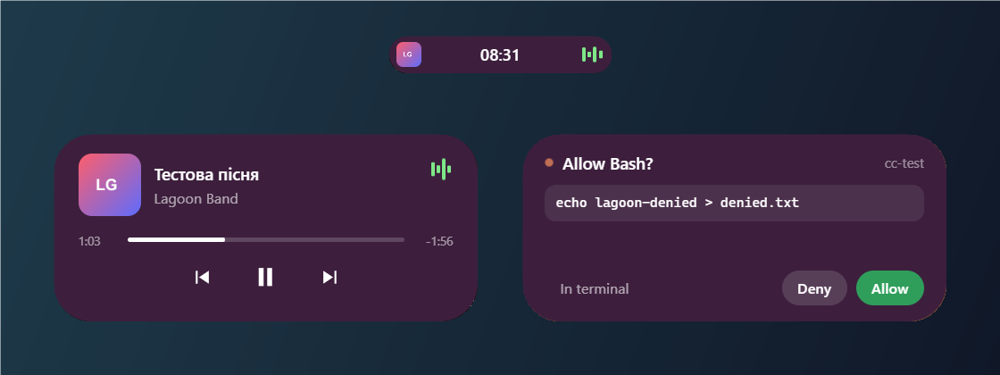

# Lagoon 🏝️

> 🇺🇦 [Українська](#українська) · 🇬🇧 [English](#english)

> **v0.3 «Стиль»** — теми й кольори, розміри, хвиля в такт музиці, анімації, `Ctrl+Alt+L` — сховати острів. Що нового — у [CHANGELOG](CHANGELOG.md). / Themes and colors, sizes, audio wave, animations, `Ctrl+Alt+L` to hide — see the [CHANGELOG](CHANGELOG.md).

---

## Українська

**Lagoon** — це «Dynamic Island» для Windows: маленька чорна пігулка вгорі (або внизу) екрана, яка розкривається при наведенні і показує корисне:

- 🕒 годинник;
- 🎵 що зараз грає (Spotify, YouTube і SoundCloud у браузері та інші програми з медіапанеллю Windows) з кнопками ⏮ ⏯ ⏭;
- 🔊 гучність саме програми, що грає (повзунок або коліщатко миші над островом), і перемотка по прогрес-бару;
- 🎤 синхронізований текст пісні окремим острівцем поруч (з [LRCLIB](https://lrclib.net)): щойно проспіваний, поточний і наступний рядок;
- ↔️ острів можна перетягнути мишею вздовж краю або вниз — він «прилипає» до найближчого краю і запам'ятовує місце;
- 🎨 теми (Класична, Графіт, Скло, свій колір), акцент з обкладинки, готові палітри, розміри й шрифт пісні;
- 🌊 хвиля вздовж краю острова в такт музиці, плавні анімації;
- 🙈 `Ctrl+Alt+L` або меню трею — сховати / показати острів;
- 🤖 статус **Claude Code** і кнопки «Дозволити / Відхилити» для запитів дозволу прямо з острова;
- 🌐 інтерфейс українською та англійською.

Зроблено на **Tauri 2** (Rust) + HTML/CSS/JavaScript.

### Скриншот



### Встановлення

1. Завантаж `Lagoon_*_x64-setup.exe` (або `.msi`) зі сторінки [Releases](https://github.com/dorawebstart/lagoon/releases/latest).
2. Запусти. Інсталятор не підписаний, тож Windows SmartScreen може попередити: «Докладніше» → «Виконати все одно».
3. Острів з'явиться вгорі екрана, іконка — у треї. Автозапуск вмикається в налаштуваннях.

> Текст пісні береться з відкритої бази LRCLIB, яку заповнюють користувачі. Для частини пісень там немає синхронізованого тексту — тоді острівця з текстом не буде. Додати текст можна, наприклад, програмою [LRCGET](https://github.com/tranxuanthang/lrcget).

### Збірка з коду

Потрібно: [Rust](https://rustup.rs) (`stable-x86_64-pc-windows-msvc`), Microsoft C++ Build Tools («Desktop development with C++»), Node.js LTS, WebView2.

```bash
git clone https://github.com/dorawebstart/lagoon.git
cd lagoon
npm install
npm run tauri dev     # запуск у режимі розробки
npm run tauri build   # інсталятор
```

### Підключення Claude Code

Острів отримує події від Claude Code через [HTTP-hooks](https://code.claude.com/docs/en/hooks): Claude Code сам надсилає запити на `http://127.0.0.1:47823/hook`, скрипти не потрібні.

1. Запусти Lagoon → іконка в треї → **Налаштування** → **Скопіювати конфіг hooks**.
2. Відкрий `~/.claude/settings.json` (`C:\Users\<ти>\.claude\settings.json`) і встав скопійоване поле `"hooks"` на верхній рівень. Якщо `"hooks"` там уже є — додай наші події до наявних.
3. Перезапусти Claude Code.

Що побачиш:

| Подія Claude Code | Острів |
|---|---|
| `UserPromptSubmit` | «Працюю…» з пульсуючою крапкою |
| `PreToolUse` | що робиться зараз, напр. «Bash: git status» |
| `PermissionRequest` | острів розкривається сам: **Дозволити / Відхилити / У терміналі** |
| `Notification` | пігулка світиться — Claude чекає на тебе |
| `Stop` | «Готово ✓» на кілька секунд |

Приклад конфігу (токен у тебе свій, генерується при першому запуску):

```json
{
  "hooks": {
    "PermissionRequest": [
      { "hooks": [{ "type": "http", "url": "http://127.0.0.1:47823/hook",
                    "headers": { "X-Lagoon-Token": "<твій-токен>" }, "timeout": 60 }] }
    ],
    "UserPromptSubmit": [ { "hooks": [{ "type": "http", "url": "http://127.0.0.1:47823/hook",
                    "headers": { "X-Lagoon-Token": "<твій-токен>" }, "timeout": 5 }] } ]
  }
}
```

- Якщо на запит дозволу не відповісти за ~55 с, Claude Code спитає в терміналі, як зазвичай.
- Якщо Lagoon не запущено, Claude Code працює як завжди (у журналі може з'явитися «hook error»).
- Сервер слухає лише `127.0.0.1`, кожен запит перевіряється токеном. Токен — секрет: не публікуй свій `settings.json`.

### Подяка

Ідея навіяна концепцією «динамічного острова» та відео про подібні застосунки для Windows. Код, назва і графіка цього проєкту — власні.

---

## English

**Lagoon** is a "Dynamic Island" for Windows: a small black pill at the top (or bottom) of the screen that expands on hover and shows:

- 🕒 a clock;
- 🎵 what's playing (Spotify, YouTube and SoundCloud in a browser and other apps that integrate with Windows media controls) with ⏮ ⏯ ⏭ buttons;
- 🔊 the volume of the playing app (slider or mouse wheel over the island) and seeking on the progress bar;
- 🎤 synced lyrics in a separate small island next to it (from [LRCLIB](https://lrclib.net)): the previous, current and next line;
- ↔️ drag the island along the edge or to the bottom — it snaps to the nearest edge and remembers its place;
- 🎨 themes (Classic, Graphite, Glass, custom), accent from the album cover, palettes, sizes and song font;
- 🌊 an audio-reactive wave along the island edge, smooth animations;
- 🙈 `Ctrl+Alt+L` or the tray menu — hide / show the island;
- 🤖 **Claude Code** status and Allow / Deny buttons for permission requests, right from the island;
- 🌐 Ukrainian and English UI.

Built with **Tauri 2** (Rust) + HTML/CSS/JavaScript.

### Screenshot


### Install

1. Download `Lagoon_*_x64-setup.exe` (or `.msi`) from [Releases](https://github.com/dorawebstart/lagoon/releases/latest).
2. Run it. The installer is unsigned, so SmartScreen may warn: "More info" → "Run anyway".
3. The island appears at the top of the screen, the icon in the tray. Enable autostart in Settings.

> Lyrics come from LRCLIB, an open community database. Some songs have no synced lyrics there — then the lyrics island doesn't appear. You can add lyrics with e.g. [LRCGET](https://github.com/tranxuanthang/lrcget).

### Build from source

Requirements: [Rust](https://rustup.rs) (`stable-x86_64-pc-windows-msvc`), Microsoft C++ Build Tools ("Desktop development with C++"), Node.js LTS, WebView2.

```bash
git clone https://github.com/dorawebstart/lagoon.git
cd lagoon
npm install
npm run tauri dev     # development mode
npm run tauri build   # installer
```

### Connecting Claude Code

The island receives Claude Code events via [HTTP hooks](https://code.claude.com/docs/en/hooks): Claude Code POSTs to `http://127.0.0.1:47823/hook` itself, no scripts needed.

1. Start Lagoon → tray icon → **Settings** → **Copy hooks config**.
2. Open `~/.claude/settings.json` and paste the copied `"hooks"` field at the top level (merge with existing hooks if you have any).
3. Restart Claude Code.

| Claude Code event | Island |
|---|---|
| `UserPromptSubmit` | "Working…" with a pulsing dot |
| `PreToolUse` | what's happening, e.g. "Bash: git status" |
| `PermissionRequest` | the island expands: **Allow / Deny / In terminal** |
| `Notification` | the pill glows — Claude is waiting for you |
| `Stop` | "Done ✓" for a few seconds |

- If you don't answer a permission request within ~55 s, Claude Code asks in the terminal as usual.
- If Lagoon isn't running, Claude Code works as usual (a "hook error" may appear in the log).
- The server listens on `127.0.0.1` only and every request is checked against a token. Keep your token secret.

### Credits

Inspired by the "dynamic island" concept and videos about similar Windows apps. All code, naming and artwork in this project are original.

## License

[MIT](LICENSE)
